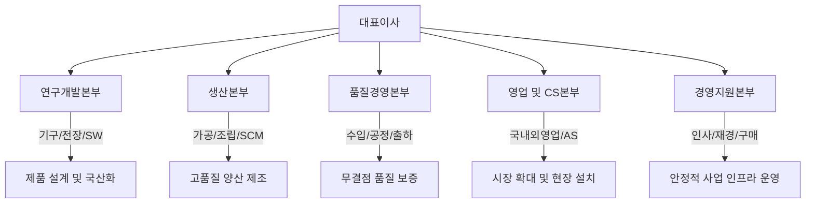

# 신규 입사자 온보딩 가이드북

대한민국 정비기기 산업을 선도하는 당사의 일원이 되신 것을 진심으로 환영합니다. 본 가이드북은 신규 입사자가 현장 안전 규범을 빠르게 체득하고, 제조 공정과 조직 협업 체계에 원활하게 안착하도록 돕기 위해 작성된 공식 온보딩 지침서입니다.

---

## 목차
1. [회사 소개 및 핵심 가치](#1-회사-소개-및-핵심-가치)
2. [첫 90일 온보딩 로드맵](#2-첫-90일-온보딩-로드맵)
3. [Day 1 첫날 기본 과업](#3-day-1-첫날-기본-과업)
4. [조직 체계 및 본부별 직무 소개](#4-조직-체계-및-본부별-직무-소개)
5. [주력 제품군 및 제조 공정 흐름](#5-주력-제품군-및-제조-공정-흐름)
6. [제조 현장 안전 수칙 및 정보 보안 지침](#6-제조-현장-안전-수칙-및-정보-보안-지침)
7. [사내 기간계 시스템 및 전산 인프라](#7-사내-기간계-시스템-및-전산-인프라)
8. [근무 제도 및 복리후생 기준](#8-근무-제도-및-복리후생-기준)
9. [정비기기 제조 핵심 용어집](#9-정비기기-제조-핵심-용어집)
10. [비상 연락망 및 담당 부서 안내](#10-비상-연락망-및-담당-부서-안내)

---

## 1. 회사 소개 및 핵심 가치

당사는 정밀한 유압 제어와 강건한 기계 구조 설계를 바탕으로 모빌리티 정비 현장의 안전과 작업 효율을 높이는 스마트 정비 솔루션을 만듭니다. 자동차 정비용 리프트부터 3D 휠 밸런서, 전자동 탈착기까지 정비사가 신뢰할 수 있는 하드웨어와 전장 소프트웨어를 자체 기술로 설계하고 생산합니다.

### 1.1 사명과 미래 지향점
우리의 미션은 고정밀 정비기기로 작업자의 생명을 보호하고 정비소의 운영 효율을 끌어올리는 데 있습니다. 이를 실현하기 위해 차세대 전기차와 자율주행 차량의 하부 구조까지 안정적으로 지지하고 진단하는 글로벌 모빌리티 정비 인프라 리딩 컴퍼니로 도약하고 있습니다.

### 1.2 임직원이 공유하는 4대 핵심 가치

* **안전 최우선 (Safety First)**  
  안전은 다른 어떤 경영 지표와도 맞바꿀 수 없는 절대적 가치입니다. 현장 작업자와 최종 사용자의 생명을 지키기 위해 국제 수준을 뛰어넘는 내구성 시험과 강도 기준을 엄격하게 적용합니다.
* **무결점 품질 추구 (Zero Defect Quality)**  
  정비 장비는 거친 정비 현장에서 10년 이상 오차 없이 작동해야 합니다. 원자재 입고 검사부터 최종 부하 작동 시험까지 단 하나의 결함도 용납하지 않는 장인정신으로 제품을 출하합니다.
* **현장 중심의 기술 혁신 (Field-driven Innovation)**  
  모든 기술 혁신의 아이디어는 정비 작업 현장의 실제 불편에서 비롯됩니다. 정비사의 작업 동선과 피로도를 분석하여 기구 구조를 개선하고 직관적인 전장 제어 인터페이스를 구축합니다.
* **원팀 협업 문화 (One Team Collaboration)**  
  설계, 생산, 품질, 기술영업이 유기적으로 소통할 때 뛰어난 제품이 완성됩니다. 부서 간 장벽을 허물고 고객 요구와 현장 이슈를 투명하게 공유하며 최선의 해결책을 함께 도출합니다.

---

## 2. 첫 90일 온보딩 로드맵

신규 입사자가 3개월 안에 독자적으로 실무를 수행하도록 돕는 4단계 성장 여정입니다. 각 단계마다 도달해야 하는 명확한 목표와 평가 기준을 두고 체계적인 OJT를 진행합니다.

```
[Day 1 ~ Week 1]       [Month 1]              [Month 2]              [Month 3]
기본 셋업 & 안전교육 ──▶ 제품/공정 이해 & 실습 ──▶ 부서 실무 OJT ──▶ 독립적 업무 수행 & 피드백
```

### 단계별 주요 추진 목표와 핵심 활동

1. **입사 1주 차 (환경 구축 및 안전 적응)**  
   사내 전산 계정을 활성화하고 공장 현장 안전 지침을 체득하는 것이 가장 중요한 과제입니다. 법정 의무 교육과 안전 장구 피팅을 마치고, 지정 멘토와 함께 부서 업무 방식을 익힙니다.
2. **입사 1개월 차 (제품 구조 및 제조 공정 이해)**  
   원자재가 완제품으로 거듭나는 전체 제조 라인을 직접 체험하고 핵심 제품의 자재명세서(BOM)를 숙지합니다. ERP와 MES의 기본 메뉴를 익혀 자재 조회와 생산 데이터 확인 방법을 습득합니다.
3. **입사 2개월 차 (단위 실무 수행 및 지침 내재화)**  
   표준작업지침서(SOP)에 근거하여 선임 지도 아래 단위 과업을 직접 실행합니다. 설계 변경(ECN) 흐름과 품질 검사 절차를 실습하며 업무 완결성을 높여 나갑니다.
4. **입사 3개월 차 (자립적 직무 완수 및 종합 평가)**  
   선임의 상시 도움 없이 통상 업무를 단독으로 처리하고 돌발 이슈 대응 능력을 검증받습니다. 90일간의 활동을 담은 수습 보고서를 작성하고 팀장 면담을 거쳐 연간 직무 성과 목표를 수립합니다.

---

## 3. Day 1 첫날 기본 과업

입사 첫날은 행정 등록과 IT 환경 구축, 소속 팀과의 라포 형성을 하루 안에 완수해야 합니다. 신원 등록과 안전 장구 지급이 신속히 이루어져야 다음 날부터 이어지는 공장 현장 투어와 직무 교육을 차질 없이 소화할 수 있습니다.

### 신원 등록 및 행정 과업
오전 중 인사총무팀을 방문하여 사원증을 발급받고 급여 및 보안 관련 법적 서류를 완비해야 합니다. 생산과 기술 연구 직군은 공장 라인 출입에 대비해 작업복 치수를 측정하고 개인 보호구를 신청합니다.
* 사원증 발급 및 출입 지문/보안 카드 등록
* 근로계약서, 개인정보 처리 동의서, 보안서약서 서명
* 주민등록등본, 급여 통장 사본, 직무 자격증 제출
* 계절별 작업복과 안전화 치수 측정 및 지급 신청

### 전산 장비 및 통신 도구 세팅
지급받은 PC의 하드웨어 상태를 살피고 사내 인트라넷과 메신저 접속을 설정합니다. 인가되지 않은 개인 프로그램 설치는 사내 망 보안 정책상 엄격히 차단되므로 전산 관리자가 배포한 표준 유틸리티만 사용합니다.
* PC/노트북 수령 및 부속 하드웨어(모니터, 마우스, 키보드) 정상 작동 확인
* 그룹웨어 포털 로그인 및 회사 이메일 계정 초기화
* 공식 협업 메신저 접속 및 프로필 사진 등록
* 층별 네트워크 복합기 드라이버 설치 및 테스트 페이지 인쇄

### 팀 합류 및 멘토링 시작
소속 부서원들과 첫인사를 나누고 지정 멘토(사수)와 일대일 오리엔테이션을 진행합니다. 구내식당 식사 시간, 휴게실 및 안전 대피로 동선을 안내받고 1일 차 업무를 정리하여 부서장에게 보고한 후 퇴근합니다.
* 팀원 상견례 및 개인 사무 공간 정돈
* 멘토 미팅: 일상 업무 루틴, 편의시설 위치, 식사 문화 안내
* 1주 차 교육 일정 확인 및 팀장 퇴근 인사

---

## 4. 조직 체계 및 본부별 직무 소개

당사의 조직은 고객 요구사항이 연구개발을 거쳐 생산과 품질, 판매 및 사후관리까지 매끄럽게 연결되도록 구성되어 있습니다. 각 본부의 고유 역할과 협업 접점을 이해하면 업무 처리 속도가 크게 향상됩니다.



### 본부별 핵심 직무 및 협업 범위

#### 1. 연구개발본부 (R&D Center)
정비기기의 기계 구조 프레임과 유압 동력원, 전장 제어반 및 진단 소프트웨어를 개발합니다.
* **기구설계팀**: 3D CAD를 이용한 메인 프레임 모델링, 유압 실린더 및 링크 기구 강도 해석, 부품 표준화
* **전장제어팀**: 메인 컨트롤러 박스 설계, PLC 및 MCU 회로 구성, 인터록 안전 센서 인터페이스 개발
* **소프트웨어팀**: 휠 밸런서 및 진단기 UI/UX 개발, 임베디드 제어 펌웨어 작성, 클라우드 정비 데이터 통신

#### 2. 생산본부
확정된 도면과 BOM을 바탕으로 원자재를 정밀 가공하고 부품을 결합하여 완제품을 조립합니다.
* **가공제관팀**: 레이저 절단기, 유압 절곡기를 활용한 후판 강재 성형 및 로봇/수동 CO2 용접
* **조립팀**: 유압 파워팩 탑재, 와이어로프 및 체인 결속, 전장 배선 연결 및 기구부 메인 체결
* **생산관리팀(SCM)**: 월간 생산 계획 편성, 자재 소요량 분석, 외주 임가공 일정 및 협력사 관리

#### 3. 품질경영본부 (QA / QC)
원자재 입고부터 완제품 출하까지 전 단계에서 엄격한 검사 기준을 적용하여 불량품 유출을 원천 차단합니다.
* **수입검사(IQC)**: 입고 강재 인장강도 확인, 유압 밸브 및 실린더 기밀성 시험, 외주 도장 두께 측정
* **공정/출하검사(FQC/OQC)**: 허용 하중의 120% 정적·동적 부하 시험, 비상 정지 인터록 작동 확인, 외관 마감 전수 검사
* **품질보증(QA)**: 사내 품질 표준(ISO) 개정, 고객 클레임 원인 역추적, 설계 변경(ECN) 유효성 평가

#### 4. 영업 및 기술서비스본부 (CS / AS)
국내외 시장에 장비를 공급하고 현장 설치, 시운전, 긴급 보수 서비스를 도맡아 고객 만족을 실현합니다.
* **국내영업팀**: 전국 대리점망 관리, 직영 서비스센터 및 대형 정비 프랜차이즈 납품
* **해외영업팀**: 북미, 유럽, 동남아 바이어 상담, 해외 안전 인증 대응, 수출 컨테이너 선적 관리
* **기술지원(A/S)팀**: 대형 리프트 현장 앵커링 설치, 시운전 지도, 정기 소모품 점검 및 긴급 출동 수리

#### 5. 경영지원본부
인재 채용과 조직 문화 구축, 예산 수립, 원자재 구매 계약 등 회사 전반의 안정적 운영을 뒷받침합니다.

---

## 5. 주력 제품군 및 제조 공정 흐름

당사는 독보적인 유압 밸런싱 기술과 고강도 구조체 설계를 바탕으로 종합 정비 라인업을 자체 공급합니다. 전 공정이 표준 작업 지침에 따라 철저하게 통제됩니다.

### 5.1 주력 제품 라인업

1. **차량 정비용 리프트 시스템**  
   정비소의 기본 설비로서 승용부터 대형 상용차까지 안전하게 인양합니다. 2주식 및 4주식 유압 리프트는 일상적인 하부 경정비에 널리 쓰이며, 시저스(Scissors) 리프트는 바닥 매립형 구조로 공간 활용도가 우수하고 정밀한 휠 얼라인먼트 작업에 필수적입니다.
2. **타이어 및 휠 서비스 장비**  
   고인치 알루미늄 휠과 런플랫(Run-flat) 타이어를 손상 없이 탈착하는 전자동 타이어 탈착기와 레이저 포인트로 납 부착 위치를 지시하는 3D 고정밀 휠 밸런서를 생산합니다. 광학 카메라 센서로 휠의 토우와 캠버 값을 측정하는 3D 얼라인먼트 시스템도 핵심 축을 이룹니다.
3. **특수 정비 진단 및 유압 공구**  
   차량 전자제어 시스템을 스캔하는 다기능 진단기, 에어컨 냉매 자동 회수·충전 장비, 엔진 탈부착용 크레인과 미션 잭 등 정비사의 근골격계 부담을 줄여주는 유압 보조 기기를 폭넓게 생산합니다.

### 5.2 표준 제조 공정 파이프라인

모든 완제품은 원자재 검수부터 포장 출하까지 다음의 6단계 엄격한 공정을 거쳐 완성됩니다.


원자재가 입고되면 즉시 강판 규격과 인장강도를 검증합니다. 통과된 강재는 최첨단 파이버 레이저 설비로 절단되고 정밀 절곡된 후 CO2 용접 라인에서 프레임 구조체로 제작됩니다. 이후 표면 이물질을 털어내는 쇼트블라스트 공정과 고온 분체 도장을 거쳐 내부식성을 확보합니다. 

메인 조립 라인에서는 유압 실린더, 유압 파워팩, 전기 배선이 프레임과 하나로 결합됩니다. 조립이 끝난 장비는 예외 없이 최대 정격 하중의 1.2배를 싣고 상하강 반복 테스트를 거쳐 안전 잠금장치의 기계적 물림을 확인한 뒤에만 최종 출하 승인을 받습니다.

---

## 6. 제조 현장 안전 수칙 및 정보 보안 지침

공장 생산 현장과 시험실은 수 톤에 이르는 중량 강재와 고압 유압, 380V 산업용 동력 전기가 흐르는 곳입니다. 안전 수칙을 준수하지 않을 경우 본인과 동료의 생명에 돌이킬 수 없는 피해를 초래하므로 모든 규칙을 예외 없이 이행해야 합니다.

### 6.1 공장 현장 5대 필수 안전 수칙

1. **개인 보호구(PPE) 상시 착용**  
   공장 구역에 들어설 때는 반드시 안전모, 안전화, 보안경, 방호장갑을 착용해야 합니다. 귀마개는 소음이 발생하는 가공 라인 출입 시 필수 착용합니다.
2. **안전 보행로 준수 및 지게차 주의**  
   바닥에 노란색 실선으로 구획된 보행 통로로만 통행하며, 운행 중인 지게차의 회전 반경 3미터 이내에는 절대 접근하지 않습니다. 보행 중 스마트폰 사용은 엄격히 금지됩니다.
3. **호이스트 크레인 하부 출입 절대 금지**  
   중량물을 인양 중인 천장 크레인 하부로는 어떠한 경우에도 통행하거나 작업하지 않습니다. 인양 전 와이어로프의 마모와 샤클 체결 상태를 먼저 점검해야 합니다.
4. **정비·보수 시 LOTO(잠금장치·경고표지) 실행**  
   기계 설비 내부를 점검하거나 전기 패널을 수리할 때는 전원 스위치와 유압 밸브를 물리적으로 차단하고 작업자 본인의 자물쇠와 경고 표지를 거치합니다.
5. **작업장 5S(정리, 정돈, 청소, 청결, 습관화) 생활화**  
   작업이 끝난 후 바닥에 묻은 유압유와 절삭유는 즉시 흡수포로 닦아내어 낙상 사고를 방지합니다. 사용한 공구는 전용 거치대에 즉각 환원합니다.

### 6.2 도면 및 기업 핵심 기술 보안

당사가 보유한 기구 설계 도면과 제어 펌웨어 소스코드는 회사의 핵심 자산입니다. 기술 자산 유출은 회사 존립을 위협하는 중대한 위법 행위이므로 철저한 보안 원칙을 따라야 합니다.
* 모든 도면 파일(DWG, STEP, PDF)은 사내 승인된 PDM 시스템을 통해서만 조회 및 배포해야 합니다.
* 개인 외장하드, 미승인 USB 메모리는 PC 연결 시 사내 보안 시스템에 의해 즉시 차단되며 감사 기록에 남습니다.
* 공장 내부 생산 설비와 시험 중인 신제품 시제품은 보안 책임자의 사전 서면 승인 없이 사진을 촬영하거나 SNS에 게시할 수 없습니다.

---

## 7. 사내 기간계 시스템 및 전산 인프라

전산 시스템의 올바른 활용은 원활한 업무 협업과 정확한 데이터 축적을 보장합니다. 당사는 ERP와 MES, PDM을 중심으로 설계부터 양산까지 데이터가 유기적으로 연동되는 환경을 운영하고 있습니다.

| 시스템 구분 | 접속 경로 | 핵심 활용 목적 |
| :--- | :--- | :--- |
| **그룹웨어 (Intranet)** | `https://gw.company.com` | 전자결재 상신, 휴가 신청, 근태 현황 조회, 전사 공지사항 확인 |
| **전사적 자원관리 (ERP)** | 사내 전용 클라이언트 | 품번 및 자재 재고 실사, 구매 발주 처리, 생산 원가 및 납품 수주 등록 |
| **제조실행 시스템 (MES)** | 공장 터치패널 및 PC | 작업지시서 실시간 조회, 조립 착수 및 완료 실적 마감, 공정 불량 등록 |
| **제품도면 관리 (PDM)** | 사내 보안 PDM 서버 | 부품 3D/2D 도면 배포, 버전 이력 관리, 설계 변경(ECN) 전자 승인 |
| **협업 메신저** | PC 및 모바일 애플리케이션 | 실시간 긴급 이슈 소통, 부서 간 프로젝트 채널 운영, 파일 공유 |

신규 입사자는 직무에 맞는 시스템 접근 권한을 멘토의 안내에 따라 1주 차 이내에 그룹웨어로 신청하여 승인받아야 합니다. 모든 시스템 계정의 초기 비밀번호는 영문 대소문자, 숫자, 특수문자를 조합하여 8자리 이상으로 즉시 변경해야 합니다.

---

## 8. 근무 제도 및 복리후생 기준

회사는 임직원이 안전하고 쾌적한 환경에서 역량을 발휘할 수 있도록 체계적인 근무 제도와 다양한 복지 혜택을 제공합니다.

### 8.1 근무 시간 및 근태 규정
표준 근무 시간은 평일 오전 8시 30분부터 오후 5시 30분까지이며, 점심 및 휴게 시간은 정오부터 오후 1시까지 1시간 동안 주어집니다. 

출퇴근 체크는 사옥 로비와 공장 입구에 설치된 사원증 리더기에 태그하거나 모바일 그룹웨어의 GPS 기반 출퇴근 기능을 이용합니다. 연차 휴가는 부서 내 업무 공백을 방지하기 위해 사용 희망일 최소 3일 전 그룹웨어 전자결재를 올려 승인받는 것을 원칙으로 합니다.

### 8.2 주요 복리후생 제도

* **식사 및 카페테리아 지원**  
  사내 구내식당에서 조식, 중식, 석식을 무료로 제공합니다. 현장 교대 근무나 잔업 시에도 신선한 식단을 차질 없이 지원합니다.
* **작업 피복 및 안전 장구 무상 지급**  
  계절별 작업복과 방한 파카, 안전화를 매년 정기 지급하며, 훼손된 안전 장구는 안전보건관리실에서 즉시 신품으로 1:1 교체해 드립니다.
* **종합건강검진 지원**  
  전 임직원을 대상으로 매년 전문 검진기관에서 종합건강검진을 지원합니다. 도장, 용접, 가공 직무 종사자는 산업안전보건법에 따른 특수건강진단을 별도로 실시합니다.
* **경조금 및 휴가 지원**  
  본인 및 가족의 결혼, 칠순, 조사 발생 시 경조 휴가와 함께 규정에 따른 경조금 및 화환, 상조 물품을 전폭적으로 지원합니다.
* **직무 자기개발 교육 지원**  
  직무 수행에 필요한 국가기술자격증(기계기사, 전기기사, 용접기능장 등) 응시료와 외부 전문 교육기관 위탁 수강료를 회사가 전액 지원합니다.

---

## 9. 정비기기 제조 핵심 용어집

도면, 회의, 현장 작업지시서에서 일상적으로 쓰이는 필수 전문 용어입니다. 이 용어들을 정확히 숙지하면 동료들과 막힘없이 소통할 수 있습니다.

| 전문 용어 | 영문 명칭 | 실무 설명 |
| :--- | :--- | :--- |
| **BOM** | Bill of Materials | 제품 한 대를 조립하는 데 투입되는 모든 부품, 가공품, 볼트류의 계층별 목록표입니다. |
| **ECN / ECO** | Engineering Change Notice / Order | 제품 품질 향상이나 원가 절감을 위해 도면 치수나 부품 규격을 변경함을 알리는 설계 변경 통보서입니다. |
| **SOP** | Standard Operating Procedure | 작업자가 공정마다 준수해야 하는 조립 순서, 토크 값, 검사 항목을 사진과 함께 정리한 표준작업지침서입니다. |
| **유압 파워팩** | Hydraulic Power Pack | 전기 모터, 유압 펌프, 오일 탱크, 압력 제어 밸브를 일체형으로 모듈화한 리프트 구동의 핵심 동력 장치입니다. |
| **토크 렌치** | Torque Wrench | 리프트 포스트 앵커 볼트나 주요 체결 부품을 정해진 회전력(N·m)에 맞추어 조이는 정밀 체결 공구입니다. |
| **LOTO** | Lockout / Tagout | 설비 보수 작업 중 타인이 전원을 켜거나 밸브를 열지 못하도록 자물쇠를 채우고 경고 표지를 거치하는 안전 절차입니다. |
| **시운전 (Run-in)** | Commissioning Test | 조립을 마친 장비에 규정 하중을 얹어 수차례 상하강을 반복하며 유압 누유, 이상 소음, 수평도를 전수 검사하는 공정입니다. |
| **CE 인증** | Conformité Européenne | 유럽연합(EU) 안전 규격 적합성 인증으로, 수출용 리프트와 산업기계가 갖추어야 하는 필수 인증입니다. |

---

## 10. 비상 연락망 및 담당 부서 안내

공장 내 안전사고가 발생하거나 전산 장애, 시설 고장이 발생했을 때는 지체 없이 담당 부서로 연락하여 지원을 받아야 합니다.

* **인사총무팀**: 사내 내선 `1001` (인사 서류, 급여, 복리후생, 증명서 발급 문의)
* **IT보안팀**: 사내 내선 `1004` (PC 하드웨어 고장, ERP/MES 계정 잠김, 네트워크 오류)
* **안전보건관리실**: 사내 내선 `1009` (현장 응급환자 발생, 보호구 지급, 시설 위험 요소 제보)
* **공무환경팀**: 사내 내선 `1010` (전기·유압 배관 고장, 냉난방 설비 점검, 크레인 이상)
* **비상 호출 (주간 경비실)**: 사내 내선 `1119` (화재 및 공장 비상사태 접수)

---

온보딩 가이드북을 학습하면서 모호한 내용이나 추가 보완이 필요한 부분이 있다면 주저하지 말고 소속 멘토나 인사팀에 의견을 제시해 주시기 바랍니다. 회사는 신규 입사자 여러분의 신선한 시각을 언제나 환영하며, 여러분이 안전하고 자부심 넘치는 환경에서 전문가로 성장하도록 온 힘을 다해 지원하겠습니다.
